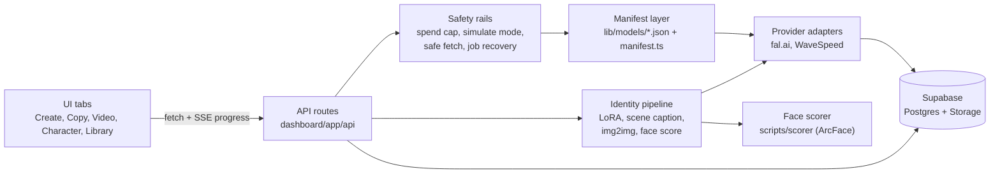

# Character Studio

One synthetic AI character, kept consistent across photos and video, built on rented models with cost controls.

<!-- DEMO: docs/media/copy-a-video.gif (20-30 s screen recording, see docs/media/SHOTLIST.md) -->
<!-- STILLS: three text-made photos of the character in a row -->

## What it does

| Workflow | Input | Output |
|---|---|---|
| Photo from text | A short prompt | Photos of the trained character |
| Copy a photo | A reference scene photo | The character in that scene, same pose and light |
| Talking clip | A still of the character and a script line | An 8 s clip with her voice (Veo 3.1) |
| Copy a video | A short motion clip | The character doing the same motion (Wan 2.2 Animate) |

The character is synthetic. She was made from text, not from a real person.

## Architecture



## How it works

### Model manifests

Each model has a JSON file in [`dashboard/lib/models/`](dashboard/lib/models/) with its input and output schema.
[`manifest.ts`](dashboard/lib/models/manifest.ts) reads these files.
[`ModelSettings.tsx`](dashboard/components/ModelSettings.tsx) builds the settings panel from the schema, so a new model needs a JSON file and no new UI code.
Each job stores the exact input sent to the provider (`provider_input`), so any result can be traced and run again.

### Identity pipeline

1. **Dataset.** A catalog of 40 shots (12 face, plus half and full body) fixes framing, angle, and light for each image. See [`lib/characters/catalog.ts`](dashboard/lib/characters/catalog.ts).
2. **Training.** The dataset is zipped and sent to a LoRA trainer on fal.ai. The trigger word comes from the character name. See [`lib/characters/`](dashboard/lib/characters/).
3. **Scoring.** A local ArcFace service compares each new image to the character's reference face. The trained LoRA scored a mean of 0.60 against a 0.60 bar. See [`scripts/scorer/`](scripts/scorer/).
4. **Text path.** A short prompt plus the trigger word goes to the LoRA model.
5. **Scene path.** A vision model captions the reference scene with the trigger word first. Then image-to-image with the LoRA runs at strength 0.7. See [`lib/characters/active.ts`](dashboard/lib/characters/active.ts).

### Video

- **Realism recipe.** Out of the box, Wan 2.2 gives clean motion and plastic skin. The motion sentence is wrapped in phone-footage wording, with matching negative prompts. See [`lib/video-presets.ts`](dashboard/lib/video-presets.ts).
- **Dry voice.** Veo voices tend to sound like a room mic, with echo. With audio on, the prompt asks for the phone's own mic and the negative prompt bans echo and reverb.
- **Copy a video.** Three steps: take the first frame of the motion clip, run Image Copy with the trained character to get a still of her in that frame, then send the still and the clip to Wan 2.2 Animate. See [`app/api/video/copy-still/route.ts`](dashboard/app/api/video/copy-still/route.ts) and [`lib/video-providers/wan.ts`](dashboard/lib/video-providers/wan.ts).

### Safety rails

- **Daily spend cap.** Every paid route checks today's tracked spend first and refuses past `MAX_DAILY_SPEND_USD`. See [`lib/spend-guard.ts`](dashboard/lib/spend-guard.ts).
- **Simulate mode.** Image jobs return a labelled placeholder at zero cost, and paid routes with no simulator refuse. It is on by default when no provider key is set. See [`lib/simulate.ts`](dashboard/lib/simulate.ts).
- **Job recovery.** Video jobs run for minutes. If the page closes, the job is found again and its result is saved. See [`app/api/video/recover/route.ts`](dashboard/app/api/video/recover/route.ts).
- **SSRF-safe fetch.** The server downloads user-supplied URLs only over https from an allowlist of hosts, and refuses raw IPs and localhost. See [`lib/safe-url.ts`](dashboard/lib/safe-url.ts).

## Numbers

Measured on real runs in November 2026. Provider prices change.

| Job | Cost | Time |
|---|---|---|
| Photo (LoRA, text or scene) | $0.01 | about 10 s |
| Talking clip, Veo 3.1, 8 s | $0.80 | |
| Motion clip, Wan 2.2 with LoRA, 5 s | $0.35 | |
| Copy a video, Wan 2.2 Animate | $0.08 per second | about 160 s for a 7 s clip |

## What I learned

- A short prompt beat a long one on the LoRA path.
- A fixed face-match bar (0.60) turned "looks like her" into a number I could test against.
- Wording matters more than settings for realism. "Shot on a phone" and a good negative prompt did more than any model parameter.
- Generated voices have an echo problem. One line that names the phone's own mic fixed most of it.
- Long jobs need a recovery path, and the save step and the recover route must not race each other.
- Hide what you have not proven. Models that failed or were not re-tested stay hidden behind a flag.

## Run it

You need Node.js 22 or later and a free Supabase project.

```bash
git clone <this repo>
cd <repo>/dashboard
npm install
cp .env.example .env.local      # fill in SUPABASE_URL and SUPABASE_ANON_KEY
```

In the Supabase SQL Editor, run the files in [`supabase/migrations/`](supabase/migrations/) in name order.
Start with `00000000000000_base_schema.sql`.

```bash
npm run dev                     # http://localhost:3000
```

With no `FAL_API_KEY` and no `WAVESPEED_API_KEY`, the app starts in simulate mode and spends nothing.
Prompt writing calls Grok or Gemini, so those keys are needed for text prompts, and those calls cost money.

The face scorer is optional: see [`scripts/scorer/README.md`](scripts/scorer/README.md).

## Known limits

- Kling Motion failed once on 2026-11-10. Seedance, Kling v3/O3, Gemini Omni, and Seedream were not re-checked after the rebuild. They are hidden by default (`SHOW_UNPROVEN_VIDEO_MODELS`).
- Sound mux from the motion clip into the Wan Animate result is not tested with real audio.
- Auto-generated names can collide.
- There is no login. The database policies allow anon access, so do not expose a deployment on the public internet without auth in front.
- Some older tabs (Publish, Carousel, Ads, Inspiration) are parked and hidden from the sidebar.
- Two React Compiler lint rules are warnings, not errors, until older components are refactored.

## Responsible use

The character is synthetic, and posts made with it carry the platform's AI label.
This tool is not for copying a real person's likeness or a real person's content.

## License

[MIT](LICENSE)
